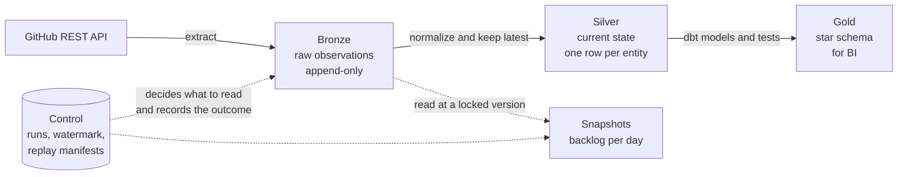

# GitHub Engineering Analytics

A small, complete data platform on Databricks. It reads the issues of a GitHub
repository (this project uses `psf/requests`), stores them safely, cleans them,
and serves them as a star schema that a BI tool can query. It is also built to
**teach**: every design choice has a reason, and the docs explain those reasons.

If you want to understand the *ideas* in this repository, start with the
[reading guide](#reading-guide) below. If you only want to run something, jump to
[Quick start](#quick-start).

## The idea in one minute

Think of a restaurant that wants to know how busy it is.

- Every order slip is kept in a drawer and **never thrown away or edited**.
  That is **Bronze**: the raw evidence.
- Each morning someone writes a tidy list of "what is the current state of every
  order". That is **Silver**: one clean row per thing.
- The owner wants a report: orders per day, per waiter, per dish. That is
  **Gold**: tables shaped for questions.
- A logbook records when the list was last updated and whether the last update
  went well. That is **Control**.

This repository does exactly that for GitHub issues, and adds two extras:
**replay** (rebuild a past state from the kept evidence) and **daily snapshots**
(see what the backlog looked like on a given day, not only today).



## Reading guide

Read in this order. Each document stands on the previous one.

| # | Document | Read it to learn |
|---|---|---|
| 1 | [Concepts](docs/01-concepts.md) | The principles behind every table and job, and a glossary. Start here. |
| 2 | [Data model](docs/02-data-model.md) | Every table: its purpose, grain, columns, keys, and how tables relate (with diagrams). |
| 3 | [The pipeline](docs/03-pipeline.md) | The job DAG, what each task does, the run lifecycle, and how failures are handled. |
| 4 | [Replay and snapshots](docs/04-replay-and-snapshots.md) | Manifests, replaying the past, and daily backlog snapshots. |
| 5 | [Operations](docs/05-operations.md) | Environments, commands, jobs, testing, releases, resetting, and troubleshooting. |

## Where things live

```text
src/github_engineering_analytics/   Python package (becomes the deployable wheel)
  api/            GitHub REST client
  bronze/         extraction and the append-only Bronze writer
  silver/         normalization and MERGE logic per entity, plus replay
  control/        runs, watermark and replay manifests (state, not analytics)
  orchestration/  the entry points a Databricks job calls
  common/         naming (PipelineConfig), Delta helpers, test-catalog reset
dbt/              Gold and snapshot models, source contracts, dbt tests
resources/        Databricks job definitions (Declarative Automation Bundles)
tests/            unit tests (no Databricks) and integration tests (opt-in)
scripts/          manual helpers for manifests, replays and comparisons
fixtures/         small data sets used by tests
```

## Quick start

You need Python 3.12, [uv](https://docs.astral.sh/uv/), the
[Go Task](https://taskfile.dev) runner and the
[Databricks CLI](https://docs.databricks.com/dev-tools/cli/install).

```bash
task setup      # install dependencies (uv sync --dev)
task check      # lint, format check, type check and unit tests
```

Always run Python tools through `uv run` (or through `task`). A tool started
outside the project environment misses the Databricks adapters and fails with
errors such as "Could not find adapter type databricks".

Everything else (deploying, running jobs, resetting a test catalog) is in
[Operations](docs/05-operations.md).

## Environments at a glance

| Target | Catalog | Purpose |
|---|---|---|
| `dev` | `github_engineering_analytics_dev` | Default development copy. |
| `test` | `github_engineering_analytics_test` | Where learning, replays and experiments happen. |
| `prod` | `github_engineering_analytics_prod` | Production-mode target. Defined, not used for experiments. |

A replay refuses to run outside a `*_test` catalog; this is enforced in code. The
daily snapshot Job is a TEST job by convention (it is named and meant for TEST) but
the code does not enforce it.

## Status

Built and proven on the TEST catalog:

- Extraction to Bronze, normalization to Silver, Gold star schema built with dbt,
  and a run lifecycle that only commits progress after Gold passed.
- Immutable replay manifests and replay of Bronze into isolated Silver tables.
- Daily snapshot models with their own manual Job.

Not built yet: reading Delta Change Data Feed, an incremental Gold build, Auto
Loader ingestion and a Lakeflow comparison. They are planned learning steps, not
features.

One proof is still open: the snapshot logic for a *changing* backlog (an issue
that closes, a label that is removed) is proven on a fixture, but the real data
contains no such change yet. See [Replay and snapshots](docs/04-replay-and-snapshots.md#what-is-proven-and-what-is-not).
