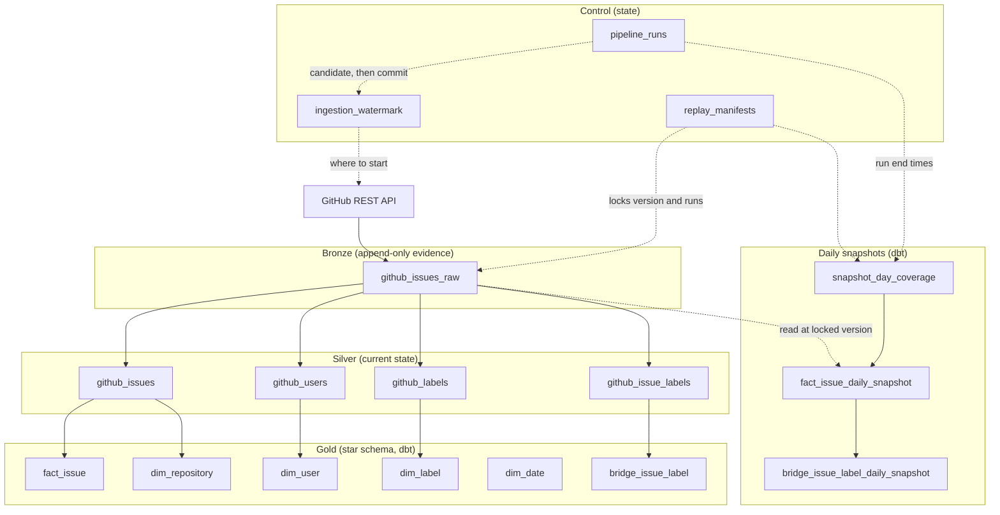
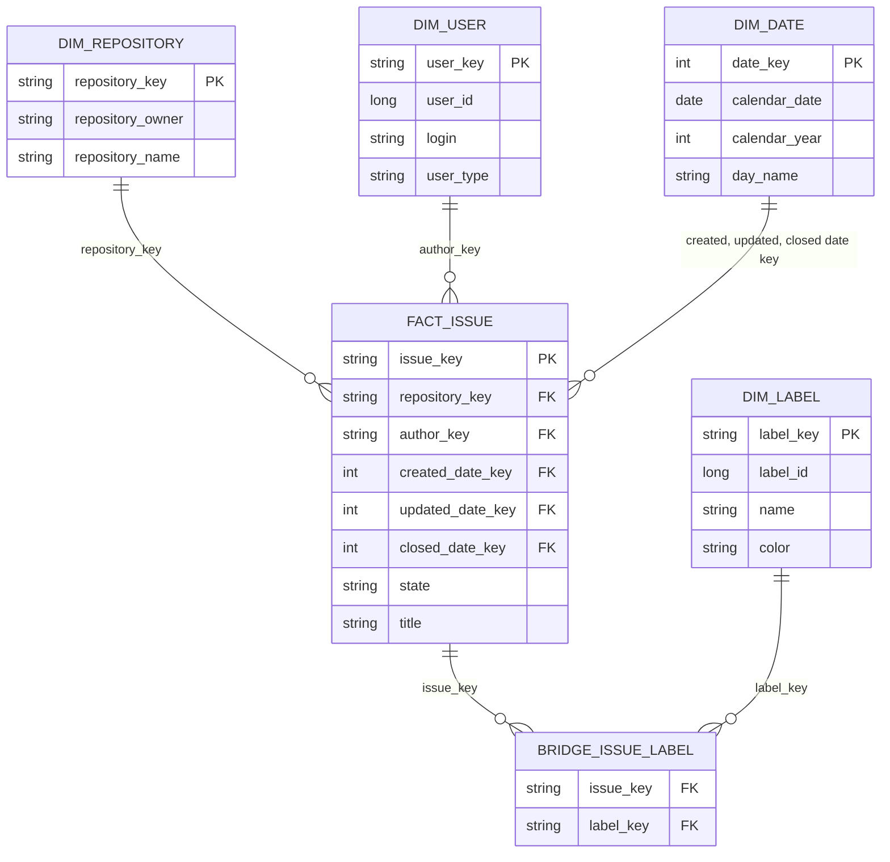

# 2. Data model

This page describes every table: **what it is for**, **what one row means**
(the *grain*), its **columns**, and **how it relates to the others**. Read
[Concepts](01-concepts.md) first if "grain" or "business key" is unfamiliar.

All tables live in one Unity Catalog catalog per environment (for example
`github_engineering_analytics_test`). Inside the catalog, each layer has its own
schema:

| Schema | Layer | Written by |
|---|---|---|
| `github_analytics_bronze` | Bronze | Python |
| `github_analytics_silver` | Silver | Python |
| `github_analytics_gold` | Gold | dbt |
| `github_analytics_control` | Control | Python |
| `github_analytics_snapshot` | Daily snapshots | dbt |
| `github_analytics_v2min` | Replay candidates (TEST only) | Python |

Table names are defined in one place: `PipelineConfig` in
[`common/config.py`](../src/github_engineering_analytics/common/config.py).

## The big picture: how the tables flow

Arrows mean "is built from". Solid arrows are the normal pipeline; dashed arrows
are the manual replay and snapshot paths.

Two things to notice:

- **Gold never reads Bronze.** It reads only Silver. If Silver is correct, Gold
  is correct.
- **Snapshots read Bronze**, at a version locked by a manifest. They must,
  because Silver keeps only the latest row per issue, so the *history* needed
  for a past day exists only in Bronze.

## Bronze

### `github_issues_raw`

- **Purpose:** the permanent record of everything we read from GitHub.
- **Grain:** one row per *observation*: one issue, as returned in one run. The
  same issue appears many times over time.
- **Written by:** the extraction step. Append only.

| Column | Meaning |
|---|---|
| `repository_owner`, `repository_name` | Which repository. |
| `issue_id` | GitHub's global id of the issue. |
| `source_updated_at` | The issue's `updated_at` as GitHub reported it. |
| `raw_json` | The complete GitHub payload, untouched. Everything else is parsed from here. |
| `_run_id` | The pipeline run that read this row. |
| `_ingested_at` | When we read it. This orders observations. |
| `_request_watermark` | The start position used for the request (null for a full load). |
| `_page_or_batch_reference` | Which page or batch of the response this row came from. |

The underscore marks *our* bookkeeping columns, as opposed to GitHub's data.

## Silver

Silver reads the Bronze rows of **one run** and merges them into four tables.
Every Silver table has a `source_run_id` column, which says which run last
changed that row. That is the lineage back to Bronze.

### `github_issues`

- **Purpose:** the current state of every issue.
- **Grain:** one row per (`repository_owner`, `repository_name`, `issue_id`).
- **Rule:** a row is updated only when the new observation's `updated_at` is
  **greater than or equal to** the stored one. An old observation can never
  overwrite a newer one, and re-running a load changes nothing.

| Column | Meaning |
|---|---|
| `repository_owner`, `repository_name`, `issue_id` | The business key. |
| `issue_number` | The number people see (`#7634`). |
| `title`, `state` | Current title; `open` or `closed`. |
| `is_pull_request` | GitHub's issues endpoint also returns pull requests; this flags them. |
| `author_user_id` | Who opened it. The id, not the login, because logins can change. |
| `created_at`, `updated_at`, `closed_at` | Timestamps in UTC; `closed_at` is null while open. |
| `source_run_id` | The run that last wrote this row. |

### `github_users`

- **Purpose:** every GitHub user we have seen as an author.
- **Grain:** one row per `user_id` (GitHub user ids are global).
- **Columns:** `user_id`, `login`, `user_type`, `source_issue_id`, `observed_at`,
  `source_run_id`.

### `github_labels`

- **Purpose:** the definition of every label.
- **Grain:** one row per (`repository_owner`, `repository_name`, `label_id`). A
  label id is only unique within a repository, so the repository is part of the key.
- **Columns:** the key, plus `name`, `color`, `description`, `is_default`,
  `source_issue_id`, `observed_at`, `source_run_id`.

### `github_issue_labels`

- **Purpose:** which labels an issue currently has. Many labels per issue, many
  issues per label: a many-to-many relationship, kept as its own table.
- **Grain:** one row per (`repository_owner`, `repository_name`, `issue_id`,
  `label_id`). One row means: this label is on this issue right now.
- **Rule:** when an issue is observed again, its relationships are *reconciled*:
  labels no longer present are deleted, new ones are added. An issue whose labels
  became empty must still delete its old relations, which is why the transformer
  returns the observed issues as well as the relationships.
- **Columns:** the key, plus `observed_at`, `source_run_id`.

## Gold

Gold is a **star schema**: one fact table in the middle, dimensions around it.

(The diagram shows the main columns only.)

| Table | Type | Grain | Built from |
|---|---|---|---|
| `fact_issue` | Fact | One current issue | `silver.github_issues` |
| `dim_repository` | Dimension | One repository | distinct repositories in `silver.github_issues` |
| `dim_user` | Dimension | One GitHub user | `silver.github_users` |
| `dim_label` | Dimension (Type 1: current values overwrite) | One label per repository | `silver.github_labels` |
| `dim_date` | Dimension (Type 0: never changes) | One calendar date | generated, 2008 to 2035 |
| `bridge_issue_label` | Bridge | One issue-label pair | `silver.github_issue_labels` |

**Why a bridge table?** An issue can have many labels and a label many issues.
Putting labels inside the fact would multiply its rows. A *bridge* holds the
pairs instead, so the fact stays at one row per issue.

**Why three date keys on the fact?** One issue has three important dates:
created, updated and closed. Each points at the same `dim_date` table (a
"role-playing" dimension), so one calendar answers all three. `closed_date_key`
is null while the issue is open.

### How surrogate keys are built

A surrogate key is a SHA-256 hash of the business key parts, joined with the text `||`. (In the table below the pipes are escaped, `\|\|`, only because Markdown tables use `|`.) The
**same formula** is used wherever the key appears, so tables join without a
lookup.

| Key | Formula |
|---|---|
| `issue_key` | `sha2(concat(owner, '\|\|', name, '\|\|', issue_id), 256)` |
| `repository_key` | `sha2(concat(owner, '\|\|', name), 256)` |
| `label_key` | `sha2(concat(owner, '\|\|', name, '\|\|', label_id), 256)` |
| `user_key` / `author_key` | `sha2(user_id, 256)` |
| `date_key` | the date as an integer `yyyyMMdd`, for example `20261018` |

The separator `||` cannot appear in a GitHub owner or repository name, so two
different keys never produce the same text.

## Control

Control tables hold **state about the pipeline**, not analytics. They never feed a
Gold table.

### `ingestion_watermark`

- **Purpose:** the committed position of the extraction: how far we have fully
  processed.
- **Grain:** one row per (`source_name`, `entity_name`).
- **Columns:** `source_name`, `entity_name`, `watermark_column` (`updated_at`),
  `watermark_value`, `overlap_seconds`, `last_successful_run_id`, `updated_at`.
- **Rule:** only the success finalizer writes it, and it only moves forward.

### `pipeline_runs`

- **Purpose:** an audit row for every pipeline attempt.
- **Grain:** one row per run (`run_id`).
- **Columns:** `run_id`, `source_name`, `entity_name`, `status`, `started_at`,
  `finished_at`, `watermark_before_value`, `watermark_before_overlap_seconds`,
  `candidate_watermark_value`, `candidate_watermark_overlap_seconds`,
  `error_message`.
- **Status:** `running`, then `succeeded` or `failed`. See
  [the pipeline](03-pipeline.md#the-lifecycle-of-a-run).

### `replay_manifests`

- **Purpose:** immutable recipes describing a frozen Bronze input.
- **Grain:** one row per manifest (`manifest_id`).
- **Columns:**

| Column | Meaning |
|---|---|
| `manifest_id` | A hash of the content below, so equal recipes have equal ids. |
| `repository_owner`, `repository_name` | The repository the recipe covers. |
| `bronze_table` | Which Bronze table. |
| `bronze_version` | The Delta version to read (time travel). |
| `successful_run_ids` | The runs whose rows are included. |
| `cutoff_at` | Upper bound (UTC) for accepted Bronze commits. |
| `code_commit`, `transformation_version` | Which code produced the recipe. |

## Replay candidates (TEST only)

A replay writes four tables per execution into `github_analytics_v2min`, named
`s2_replay_<entity>_<execution_id>` with entity `issues`, `users`, `labels` or
`issue_labels`. They have the same columns as their Silver twin plus
`manifest_id` and `replay_execution_id`. They are throw-away comparison copies,
never read by Gold. See [Replay and snapshots](04-replay-and-snapshots.md).

## Daily snapshots

Built by dbt into `github_analytics_snapshot` for one manifest and a date range.

| Table | Grain | Purpose |
|---|---|---|
| `snapshot_day_coverage` | One calendar date | Says whether the day was `observed` or `missing`. |
| `fact_issue_daily_snapshot` | One issue per **observed** date | The state of each issue at the end of that day: `state`, `is_open_on_date`, `age_days`, plus `issue_key`, `repository_key`, `observation_run_id`, `observed_at`, `manifest_id`. |
| `bridge_issue_label_daily_snapshot` | One issue-label pair per observed date | Which labels each issue had that day, with `issue_key`, `label_key`, `observation_run_id`, `manifest_id`. |

The keys use the same formulas as Gold, so a snapshot row joins to `fact_issue`,
`dim_repository` and `dim_label`.

## Which table answers which question?

| Question | Table |
|---|---|
| How many issues are open **right now**? | `gold.fact_issue` where `state = 'open'` |
| Who opened the most issues? | `fact_issue` joined to `dim_user` |
| How many issues did each label get? | `bridge_issue_label` joined to `dim_label` |
| How many issues were created per month? | `fact_issue` joined to `dim_date` on `created_date_key` |
| What was the backlog **on 12 October**? | `snapshot.fact_issue_daily_snapshot` for that date |
| Did we even observe 14 October? | `snapshot.snapshot_day_coverage` |
| What exactly did GitHub tell us, and when? | `bronze.github_issues_raw` |
| Did the last run finish, and where did we stop? | `control.pipeline_runs`, `control.ingestion_watermark` |
| Which input does this replay reproduce? | `control.replay_manifests` |

Next: [3. The pipeline](03-pipeline.md).
