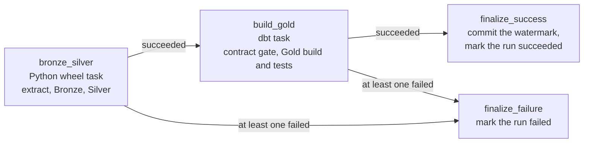
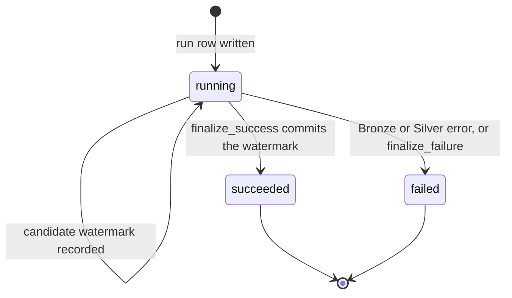

# 3. The pipeline

This page follows one run from start to finish: what happens, in which order,
what is written where, and what happens when something goes wrong. The tables
are described in [Data model](02-data-model.md); the ideas (candidate versus
commit, watermark, overlap) in [Concepts](01-concepts.md).

## The job at a glance

The normal run is one Databricks Job, `GitHub Issues Bronze-to-Gold load`
(resource `github_issues_full_load`). It is a **DAG**: tasks with dependencies.
A task starts only when the tasks it depends on have finished.



Two tasks end the job, and exactly one of them does real work:
`finalize_success` runs only when everything before it succeeded;
`finalize_failure` runs only when something failed (`run_if: AT_LEAST_ONE_FAILED`).

## Task by task

### 1. `bronze_silver` (Python)

Entry point `github-engineering-analytics-full-load`, implemented in
[`orchestration/tracked_load.py`](../src/github_engineering_analytics/orchestration/tracked_load.py).
In order:

1. **Create the control tables** if they do not exist, so a failure always has
   somewhere to be recorded.
2. **Read the committed watermark.** This decides the mode:
   - no watermark yet: a **full load** (read every issue);
   - a watermark: an **incremental load** starting at the watermark *minus the
     overlap* (5 minutes).
3. **Write a `pipeline_runs` row** with status `running`. The run id is the
   Databricks job-run id, so every task of the job refers to the same row.
4. **Extract from GitHub** and **append to Bronze**. The GitHub token comes from
   a Databricks secret scope; the token never appears in configuration.
5. **Update Silver** from the Bronze rows of *this run only*, in a fixed order:
   issues, users, labels, then issue-labels. The relationship table comes last
   because it refers to issues and labels.
6. **Record the candidate watermark** on the run row. The status stays `running`.

If anything raises, the run is written as `failed` (with the error message) and
the exception is re-raised so the Databricks task fails. The task is configured
with `max_retries: 0`, because Bronze is append-only: an automatic retry could
append the same rows twice.

### 2. `build_gold` (dbt)

A native Databricks dbt task, running two commands:

1. `dbt test --select source:silver`: the **contract gate**. It checks the Silver
   tables (keys unique, required columns not null) *before* trusting them. If
   Silver is invalid, Gold is never built.
2. `dbt build --select tag:gold`: builds the Gold models and runs their tests.

In this task dbt only reads Silver and only writes Gold. (The snapshot models are a separate, manual Job, and they do read Bronze and Control; see the next page.)

### 3. `finalize_success` (Python)

Entry point `github-engineering-analytics-finalize-success`, in
[`orchestration/finalizer.py`](../src/github_engineering_analytics/orchestration/finalizer.py).
Because it runs only after Gold passed, this is the one place where progress is
committed:

1. If the run is already `succeeded`, do nothing (safe to repeat).
2. If the run is `failed`, refuse: a failed run is never turned into a success.
3. **Commit the candidate watermark** to `ingestion_watermark`.
4. **Mark the run `succeeded`** with its finish time.

The order matters. If the job dies between step 3 and step 4, the run is still
`running`; a retry replays the watermark commit (which is idempotent) and then
completes the status. No source position is lost.

### 4. `finalize_failure` (Python)

Entry point `github-engineering-analytics-finalize-failure`. It marks a still
`running` run as `failed` with a generic reason. If an upstream task already
recorded the failure (as `bronze_silver` does), this is a safe no-op. It never
changes the watermark.

## Why the finalizer is a separate task

The watermark must move **only if Gold also succeeded**. A single Python task
cannot know that, because dbt runs in another task. By making the commit its own
task that depends on `build_gold`, the Job structure itself enforces the rule:
no Gold, no commit. This is why the Job result of a *handled* failure shows
`SUCCESS_WITH_FAILURES`: the failure was handled correctly. Alerts are therefore
configured per task, not on the whole Job.

## The lifecycle of a run



`succeeded` and `failed` are **terminal**: nothing changes them afterwards. The
control row also keeps `watermark_before_value`, `candidate_watermark_value` and
`error_message`, so one row tells the whole story of an attempt.

## Full load, incremental load and re-running

- **Run 1** has no watermark, so it reads everything. Bronze gets one row per issue.
- **Run 2** reads only issues updated since `watermark - 5 minutes`. Issues that
  were re-read get a *second* Bronze row; Silver keeps the newer one.
- **A failed run** leaves the watermark where it was. The next run starts from the
  same place and re-reads what the failed run read. Its Bronze rows stay, as
  history, but carry a `failed` run id, so a replay manifest can exclude them.
- **Re-running is safe** because Silver merges by business key, only ever moves
  forward in time, and Gold is rebuilt from Silver.

## When something fails

The pipeline has two recovery modes. Choose from the persisted
`pipeline_runs.status`, not only from the Databricks job result.

| Failure boundary | Control status | Safe recovery |
|---|---|---|
| Bronze or Silver task | `failed` | Fix the cause and start a **new** complete job run. Do not repair append-only Bronze. |
| dbt Gold task | `failed` | Fix the dbt cause and start a **new** complete job run. The committed watermark is unchanged. |
| `finalize_failure` task | `running` | Repair only `finalize_failure` from the original Databricks run. |
| `finalize_success` task | `running` | Repair only `finalize_success` from the original Databricks run. |
| Completed run | `succeeded` | No action. The success finalizer is idempotent. |
| Failed run | `failed` | Never repair it into success. Start a new complete run after fixing the cause. |

Before choosing, inspect the durable record:

```sql
SELECT
  run_id,
  status,
  started_at,
  finished_at,
  watermark_before_value,
  candidate_watermark_value,
  error_message
FROM <catalog>.github_analytics_control.pipeline_runs
WHERE run_id = '<job_run_id>';
```

`task monitor:health:test` prints recent lifecycles and the committed watermark
for the TEST catalog.

## Proving the failure path

A failure path that has never been exercised is a guess. The Job
`[TEST] GitHub Gold failure-path probe` (resource `github_gold_failure_probe`)
runs the normal tasks and then **fails on purpose** after a successful Gold
build, using the macro `fail_gold_gate` (it must never be added to the normal
DAG). The expected result: the run is `failed`, and the committed watermark did
not move. That proves the commit-after-Gold rule holds when it is needed.

Next: [4. Replay and snapshots](04-replay-and-snapshots.md).
