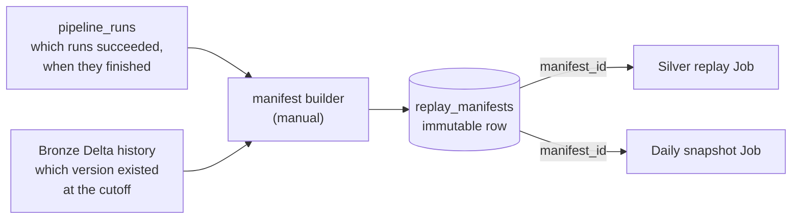
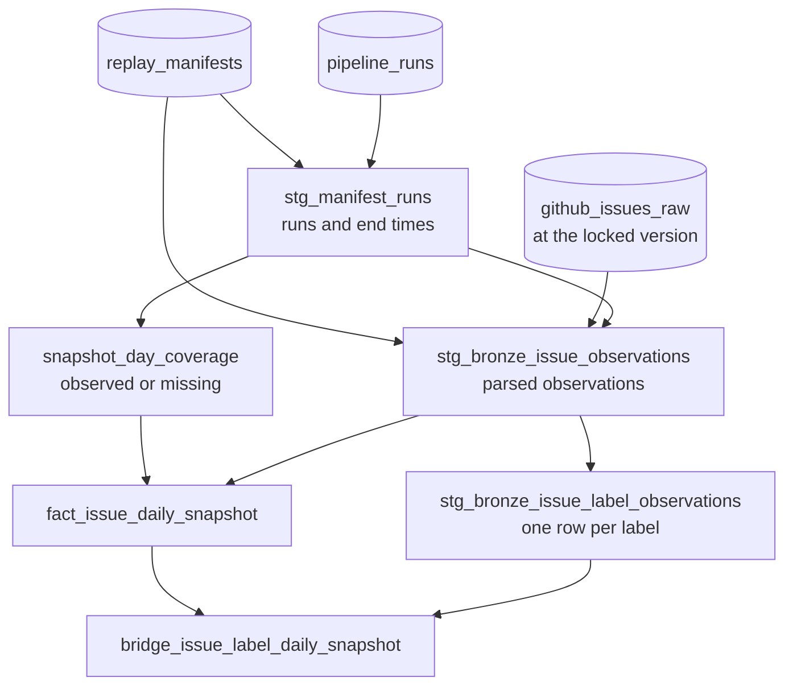

# 4. Replay and snapshots

The normal pipeline answers "what is the state **now**?". This page covers two
tools for the **past**:

- **Replay**: rebuild Silver from a frozen input, to prove the logic is
  repeatable or to test a change without touching live data.
- **Daily snapshots**: show what the backlog looked like on a given day.

Both stand on one idea, the manifest. Read [Concepts](01-concepts.md) first if
"append-only", "Delta time travel" or "watermark" are new.

Both tools are **manual** and meant for the TEST catalog. They are not part of the
normal Job. The replay **enforces** this in code (it refuses a catalog that does not
end in `_test`). The snapshot Job is a TEST job by convention only: its models would
run in any catalog you deploy it to, so do not point it at a production catalog.

## Why the past can be reproduced

Bronze never changes, and Delta numbers every write ("version 475", "version
476"). So "Bronze as it was after the last good run" is a precise, repeatable
thing: *this table at this version, limited to these runs*. That description is a
**replay manifest**.



### What the builder does

[`orchestration/manifest_builder.py`](../src/github_engineering_analytics/orchestration/manifest_builder.py)
turns a list of run ids into one stored manifest:

1. Every run must be `succeeded` and must have **finished before the cutoff**;
   otherwise it refuses. A failed or still-running run only wrote part of its
   data, and a run that finished after the cutoff has some of its Bronze commits
   *after* the version we pick, so it would be read only in part.
2. The cutoff is chosen by the caller (the helper script uses the finish time of
   the latest run). It is the moment the input is considered complete.
3. It finds the **newest Bronze Delta version committed at or before the cutoff**
   and stores that number.
4. It checks the input can really be read (the version still exists, every run
   contributes rows).
5. The `manifest_id` is a **hash of the content** (repository, table, version, sorted run ids, cutoff and code version). The same recipe always gets the
   same id, and storing it twice is harmless. A manifest is never edited.

Create one with `scripts/first_manifest.py --run-id <id> --run-id <id> ...`. The
script also checks that an unknown or expired version fails and that the
watermark did not move.

### Why a manifest is not the watermark

| | Watermark | Manifest |
|---|---|---|
| Question | Where does the **next live run** start? | Which **past input** do I want to reproduce? |
| Written by | The success finalizer, automatically | A person, on demand |
| Changes? | Moves forward every run | Never changes |
| Used by | The normal pipeline | Replay and snapshots only |

Creating or using a manifest never moves the watermark.

## Replay

**Goal:** apply the *current* Silver logic to a *frozen* Bronze input, writing the
result to separate tables, and compare it with live Silver.

The core is in
[`orchestration/silver_replay.py`](../src/github_engineering_analytics/orchestration/silver_replay.py).
For one manifest and one `execution_id` it:

1. Reads Bronze at the manifest's version, for the manifest's repository and runs
   only.
2. Runs the **same transformers** as the live pipeline, producing the four Silver
   entity sets. They keep the latest observation per key.
3. Checks everything **before the first write** (Delta cannot commit four tables
   atomically), including that no target table exists yet.
4. Writes four new tables, `github_analytics_v2min.s2_replay_<entity>_<execution_id>`,
   with the write mode `error`, so an existing result is never overwritten.

Safety rules, enforced in code:

- The catalog must end in `_test`.
- The output schema is fixed in code, not a parameter, so a replay cannot be
  pointed at a live schema.
- `execution_id` is 1 to 40 characters of `[a-z0-9_]`, because it becomes part of
  a table name.
- The manifest's Bronze table must be this catalog's Bronze table.
- A failure halfway lists exactly which tables to remove by name.

### Running it

```bash
task bundle:deploy:test
task replay:silver:test -- manifest_id=<manifest id>,execution_id=<new id>
```

Every replay needs a **new** `execution_id`. Compare two executions, and each of
them with live Silver, with:

```bash
uv run python scripts/compare_silver_replays.py --first <id> --second <id>
```

Business columns must match exactly. The `source_run_id` lineage column may
differ only where live Silver names a *failed* run, because a failed run can
still update live Silver before it fails while a replay of the successful runs
never uses it.

The Bronze version must still exist: it has to be inside the table's retention
window (30 days in TEST), otherwise the replay stops before writing.

## Daily snapshots

**Goal:** answer "what did the backlog look like on 12 October?", which neither
Gold nor Silver can answer, because both only know the latest state.

### Why Bronze, not Silver

Silver keeps **one row per issue**, the newest. If an issue was open on the 10th
and closed on the 12th, Silver only knows "closed". The fact that it was open on
the 10th survives only in Bronze, as an older observation. So the snapshot models
read **Bronze at the manifest's locked version**.

### The two rules

For a chosen manifest and date range:

1. **Coverage.** A day is `observed` if a successful run of the manifest
   **finished on that day** (UTC). Otherwise it is `missing`. Missing days get no
   issue rows at all: a gap must never look like an empty backlog.
2. **State on a day.** For each issue, take the **newest observation ingested
   before the end of that day**. That row says whether the issue was open or
   closed and which labels it had. If nothing newer arrived, the previous state
   carries forward.

### The models



| Model | Kind | Role |
|---|---|---|
| `stg_manifest_runs` | staging (ephemeral) | The manifest's runs with their finish times. |
| `stg_bronze_issue_observations` | staging (ephemeral) | Bronze at the locked version, restricted to the manifest, with `raw_json` parsed. |
| `stg_bronze_issue_label_observations` | staging (ephemeral) | One row per label per observation. An observation with no labels gives no rows, which is how a removed label shows up. |
| `snapshot_day_coverage` | table | One row per date: `observed` or `missing`. |
| `fact_issue_daily_snapshot` | table | One issue per observed date, with `is_open_on_date` and `age_days`. |
| `bridge_issue_label_daily_snapshot` | table | The labels of each issue on each observed date. |

"Ephemeral" means dbt writes nothing for the model; it is inlined into the models
that use it.

The staging model reads the Bronze **version from the manifest itself** while
compiling, so the version can never disagree with the manifest. It also
re-declares the shape of the GitHub JSON, because the Python parsing cannot be
called from SQL. A unit test
([`tests/unit/test_dbt_payload_schema.py`](../tests/unit/test_dbt_payload_schema.py))
fails if those field names drift from the Python schemas.

### A worked example

One issue, `psf/requests` #1, created on 9 October. Two runs, three days.

| Date | What happened | Coverage | The issue on that day |
|---|---|---|---|
| 10 Oct | `run_a` finished; the issue was open with label `bug` | observed | open, age 1, label `bug` |
| 11 Oct | no run finished | **missing** | **no rows at all** |
| 12 Oct | `run_b` finished; the issue was closed, the label removed | observed | closed, age 3, no label |

Notice what does **not** happen: 11 October is not shown as "zero open issues",
and the label `bug` stays on 10 October after it was removed on the 12th. This
exact scenario is the fixture in the dbt unit tests.

### Running it

The Job `[TEST] GitHub daily snapshot` (resource `github_daily_snapshot`) runs
`dbt build --select daily_snapshot` with three parameters:

```bash
databricks bundle run -t test github_daily_snapshot \
  --params manifest_id=<id>,start_date=2026-10-12,end_date=2026-10-16
```

The output lands in the schema `github_analytics_snapshot`. Locally, the same
build is:

```bash
uv run dbt build --project-dir dbt --profiles-dir dbt --select daily_snapshot \
  --vars '{"snapshot_manifest_id": "<id>", "snapshot_start_date": "2026-10-12", "snapshot_end_date": "2026-10-16"}'
```

Rebuilding with the same manifest and dates gives **identical rows** (checked by
comparing the new Delta version with the previous one in both directions).

### How it is tested

- **dbt unit tests** run the three models against the fixture above and need no
  warehouse tables. The staging inputs are `ephemeral`, so the fixtures are written
  as SQL (`format: sql`) with explicit types; dbt cannot read column types from a
  model that has no table.
- **Key tests** compare the surrogate keys with the same hash formulas that Gold
  uses, so a snapshot row joins to `fact_issue`, `dim_repository` and `dim_label`.
- **Mutation checks** broke the key formula and the JSON schema on purpose and
  confirmed the tests fail.

## What is proven and what is not

Proven on real TEST data: the gap logic (missing days have no rows), unique grain,
carried-forward state, keys that join to Gold, and repeatable rebuilds.

**Not yet proven on real data:** an issue that actually changes. In the real data
the few issues seen twice did not change state, labels or title, so the backlog is
identical on every observed day. The status change and the removed label are
proven on the fixture only. A real proof needs a second pipeline run on another
day after a real change on GitHub, then a new manifest covering both runs.

Next: [5. Operations](05-operations.md).
