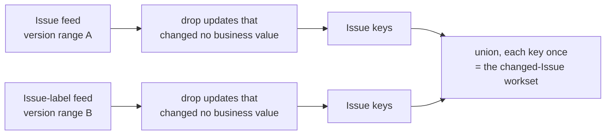

# 6. Change Data Feed: finding what changed

The pipeline builds Gold from Silver. Today it rebuilds everything every time.
This page explains the tool that makes a smaller rebuild possible: reading **only
the Issues that changed** between two points in time. Read
[Concepts](01-concepts.md) first if "MERGE", "Delta version" or "lineage" are new.

> **Status.** This is proven on TEST with invented runs and small fixture tables.
> It is **not** switched on for the real Bronze and Silver tables yet, and nothing
> in the normal pipeline uses it. See [What is not done yet](#what-is-not-done-yet).

## The problem

Imagine Silver holds 7,233 Issues and a run changes 12 of them. Rebuilding all
7,233 wastes work. We need a cheap answer to one question: *which Issues changed
since the last time I looked?*

Comparing two full copies of a table would answer it, but that reads everything,
which is the cost we wanted to avoid.

## What the Change Data Feed is

Delta numbers every write to a table ("version 2", "version 3"). The **Change Data
Feed (CDF)** is an optional extra log: for each version it also records *which rows
were inserted, updated or deleted*. You then ask for the changes between two
versions and get only those rows.

Each row of the feed carries three extra columns:

| Column | Meaning |
|---|---|
| `_change_type` | `insert`, `delete`, `update_preimage` (the row before) or `update_postimage` (the row after) |
| `_commit_version` | The Delta version that made the change |
| `_commit_timestamp` | When that version was committed |

An example. Issue 1 is closed in version 3, and Issue 4 is created in the same
version:

| issue_id | state | `_change_type` | `_commit_version` |
|---|---|---|---|
| 1 | open | `update_preimage` | 3 |
| 1 | closed | `update_postimage` | 3 |
| 4 | open | `insert` | 3 |

Notice that an update is **two rows**: the old version and the new version.

## Four rules that are easy to get wrong

These were all learned by testing on TEST, not by reading documentation.

1. **It is not retroactive.** CDF only records writes made *after* it was switched
   on. Asking for a range that starts earlier fails with `DELTA_MISSING_CHANGE_DATA`.
   Switch it on **before the first data commit**, or the early history is lost for
   good.
2. **It records writes, not business changes.** Our Silver writers use a MERGE, and
   a MERGE rewrites every row it matches. If GitHub's data is read again but nothing
   changed, Delta still logs an update pair, because only a lineage column
   (`source_run_id`) changed. Without care, Issues that did not really change show
   up as changed.
3. **Each table has its own version numbers.** "Version 3" of the Issues table and
   "version 3" of the labels table are unrelated. Every table is read with its own
   range.
4. **On serverless compute the table property must be set per table.** The session
   setting that turns CDF on by default is not available there. Use
   `ALTER TABLE ... SET TBLPROPERTIES ('delta.enableChangeDataFeed' = 'true')`.

CDF is also **not a permanent archive**. Old versions disappear after the table's
retention period, and then a range that used to work no longer does.

## Why two tables are read

An Issue is described by two Silver tables: the Issue row (`github_issues`) and its
label relations (`github_issue_labels`). A change in either one affects the Issue.

The label table matters for a case the Issue table cannot see. If an Issue loses its
last label, **the Issue row does not change at all**. Only a row disappears from the
label table. Reading just the Issue feed would miss it.

The set of affected Issues is therefore the **union** of the keys found in both
feeds:



## The code

Everything lives in
[`silver/changed_issues.py`](../src/github_engineering_analytics/silver/changed_issues.py).

```python
from github_engineering_analytics.silver.changed_issues import (
    ChangeRange,
    changed_issue_keys,
)

workset = changed_issue_keys(
    spark,
    issues_table=config.silver_issues_table,
    issues_range=ChangeRange(start_version=3, end_version=3),
    issue_labels_table=config.silver_issue_labels_table,
    issue_labels_range=ChangeRange(start_version=3, end_version=3),
    issues_lineage_columns=("source_run_id",),
    issue_labels_lineage_columns=("source_run_id", "observed_at"),
)
```

| Piece | Purpose |
|---|---|
| `ChangeRange` | The versions to read **for one table**, both ends inclusive. It refuses a negative or reversed range. |
| `changed_issue_keys` | Reads both feeds and returns each affected Issue key once. |
| `*_lineage_columns` | Columns that say where a row came from, such as `source_run_id`. A change in them alone is not a real change. The default is none, which keeps every value column. |
| `ChangeRangeUnavailableError` | One clear error when a range cannot be read. It names the table and the versions and says to decide between a bootstrap and a replay. |

### How the "real change" filter works

`insert` and `delete` rows always count: a row that appeared or disappeared is a
change. An update is two rows, so the filter pairs them. The pair is matched on the
row's key and the commit version, and then the whole row before is compared with the
whole row after, ignoring the lineage columns. If every business value is equal, the
update was only a rewrite and is dropped.

Two details matter:

- **Two NULLs count as equal.** A plain `=` says NULL is never equal to NULL, which
  would make an unchanged open Issue (its `closed_at` is NULL both times) look
  changed. The comparison is null-safe.
- **Labels are paired per row, not per Issue.** A label row is identified by the
  Issue key *and* the label id. Pairing per Issue would match label 100's "before"
  with label 101's "after", and an unchanged Issue would look changed.

## A worked example

Two invented runs go through the real Bronze writer, transformers and MERGE writers
into a scratch schema. Run 1 is the baseline, run 2 changes things:

| Issue | In run 2 | Real change? | In the workset? |
|---|---|---|---|
| 1 | Closed | Yes (the row changed) | Yes |
| 2 | Loses its last label | Yes (only the label feed sees it) | Yes |
| 3 | Gains a label | Yes (only the label feed sees it) | Yes |
| 4 | New | Yes (an insert) | Yes |
| 5 | Read again, identical | **No** (only `source_run_id` changed) | **No** |

Without the lineage columns the workset was `[1, 2, 3, 4, 5]`: correct but too big,
because Issue 5 was merely rewritten. With them it is exactly `[1, 2, 3, 4]`.

## How it is tested

| Level | What | Where |
|---|---|---|
| Unit tests | The wiring: which options are set, which columns are chosen, how errors are reported, how the lineage columns are picked. They cannot see mistakes inside the filter, because they replace it with a stand-in. | `tests/unit/test_changed_issues.py` |
| Integration tests | The filter itself, on small hand-made change feeds with no table: inserts and deletes kept, real updates kept, lineage-only updates dropped, NULLs equal, labels paired per row. | `tests/integration/test_changed_issues_integration.py` |
| Live scripts | The whole thing against real Delta tables on TEST. | `scripts/check_changed_issues.py`, `scripts/build_cdf_projection.py` |

The split exists for a reason: a typo in the filter (`"inserts"` instead of
`"insert"`) once passed every unit test, because they never run the filter. The
integration test now catches it.

Run the integration tests (they write nothing, but they need Databricks):

```bash
RUN_DATABRICKS_INTEGRATION_TESTS=1 DATABRICKS_TEST_CATALOG=<catalog> \
  uv run pytest tests/integration/test_changed_issues_integration.py -m integration
```

The two live scripts work on scratch objects in TEST.

- `build_cdf_projection.py` builds its own scratch schema from scratch, and refuses
  to run if that schema already exists. It is repeatable: drop the schema
  `github_analytics_s4_projection` first, then run it.
- `check_changed_issues.py` proves the failure case. It creates one scratch table
  with the change feed switched on *late*, asks for a range that starts before
  that, and expects the one clear error. It creates and drops its own table, so
  nothing needs to exist beforehand and it can be run any time.

```bash
uv run python scripts/build_cdf_projection.py   # proves the right Issues are found
uv run python scripts/check_changed_issues.py   # proves an unreadable range fails clearly
```

## What is not done yet

Be clear about the limits of what was proven:

- **CDF is off on the real tables.** The real Bronze and Silver tables on TEST do
  not have it, and the Silver writers do not switch it on. Because CDF is not
  retroactive, the history before it is enabled can never be recovered. Turning it
  on for the real Silver tables is a decision for the next step, not a given.
- **No real Job runtime.** The checks ran through Databricks Connect and on a SQL
  warehouse, not inside a deployed Job on the serverless environment the Jobs use.
- **No real change in real data.** The proof uses invented runs. The real TEST data
  has not had an Issue that closed or changed labels between two runs.
- **Deletions at the source are invisible.** If GitHub removes an Issue, a later
  full load simply does not return it. Bronze is append-only and Silver never
  deletes it, so CDF never sees a delete. Between two full loads on TEST the count
  fell from 7,250 to 7,233 Issues. The cause was not established (a removal or a
  transfer on GitHub is one possibility), but it shows that such a case can happen.
  Handling it is a separate design question.
- **Cost is not measured.** The filter pairs rows with a join. That is fine for
  7,233 Issues; the cost on larger tables has not been measured.

Back to the [README](../README.md).
