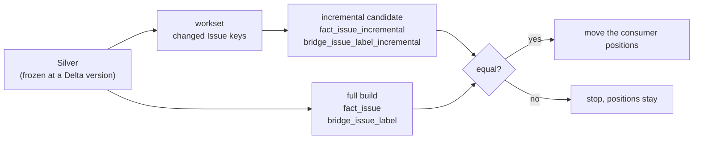
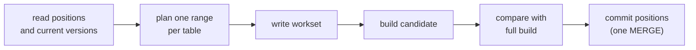

# 7. The incremental Gold candidate

The normal pipeline rebuilds the whole Gold layer on every run. This page explains
the experiment that builds **only the Issues that changed**, and how we prove that
the smaller build gives exactly the same answer as the full one. Read
[Change Data Feed](06-change-data-feed.md) first: it explains how the changed
Issues are found.

> **Status.** This is a **learning route on TEST**, proven on invented runs in
> scratch schemas. The real Gold tables, the real Jobs and the existing consumers
> are untouched, and Change Data Feed is not switched on for the real tables yet.
> See [What is not done yet](#what-is-not-done-yet).

## The idea

Speed is only worth having if the result stays the same. So the rule of this
experiment is: **the incremental build must equal a full build**, row for row, for
the cases that are easiest to get wrong.



Four pieces make this work.

## 1. The workset as a table

dbt can only read tables, so the changed-Issue keys from the Change Data Feed are
written to a Delta table first.

[`write_workset`](../src/github_engineering_analytics/orchestration/workset_table.py)
writes one row per changed Issue, with only the three key columns. It is built to be
safe to run by accident:

- It only runs in a catalog whose name ends in `_test`.
- The schema must match `github_analytics_s5_` followed by 1 to 40 lowercase letters,
  digits or `_`, matched in full, so a live schema name or `x; DROP` is refused.
- The table is **overwritten**, never appended to: a workset belongs to exactly one
  batch, so a stale batch cannot leak into the next one.
- After writing it counts the rows and fails if the count differs.

## 2. The candidate models

They live in `dbt/models/gold_candidate/`, not in `gold/`, so nothing serves them
to BI. Their tables carry an `_incremental` suffix.

| Model | Strategy | What it does |
|---|---|---|
| `fact_issue_incremental` | `merge` on `issue_key` | First run: reads all of Silver. Later runs: reads only the Issues in the workset and merges them in. |
| `bridge_issue_label_incremental` | `append` plus a pre-hook | A pre-hook deletes every bridge row of the workset Issues, then the model appends their current rows. |

The bridge needs the extra step because of one case. If an Issue **loses its last
label**, there is no new row to merge on, so a merge would leave the old row behind.
The delete therefore comes from the **workset**, not from the new rows. An Issue with
no labels left gets the delete but adds no rows. Running the same batch twice gives
the same table, because the second delete undoes the first append.

Both models filter with `where exists (...)` against the workset. Unlike a join, it
cannot multiply rows, even if the workset had a duplicate.

Two inputs are variables, so a proof can point dbt elsewhere without changing the
models: `silver_schema` (where Silver is read) and `workset_schema` (where the
workset table lives). A safety net in the schema macro refuses a build that reads a
different Silver but has no `gold_output_schema`, because it would overwrite the real
Gold tables with results from a frozen copy.

## 3. The same input for both builds

The live Silver moves on with every run, so a full build and an incremental build
would see different input. The proof therefore first copies the four Silver tables at
**pinned Delta versions** into their own schema
([`freeze_silver`](../src/github_engineering_analytics/orchestration/silver_freeze.py)).
Each table has its own version numbers, so each is pinned separately.

[`scripts/compare_gold_candidate.py`](../scripts/compare_gold_candidate.py) then
compares the candidate with the full build in both directions (`EXCEPT ALL`, so a
duplicate row counts) and compares the row counts.

## 4. Positions that move last

The consumer must remember how far it has read. A control table
([`DeltaCdfConsumerPositionRepository`](../src/github_engineering_analytics/control/cdf_consumer_position_repository.py))
stores one row per consumer and source table: the last Delta version processed.

- **All positions are written in a single MERGE**, so the Issues position and the
  labels position move together or not at all.
- A position **never moves back**: the MERGE only updates when the new version is
  equal or higher.
- The next range is `position + 1` up to the current version.

[`run_batch`](../src/github_engineering_analytics/orchestration/incremental_batch.py)
fixes the order:



Anything that fails before the last step leaves the positions where they were, so the
next run reads the same range again. Nothing is skipped.

Two rules protect the first run:

- The first run has no position, so it needs an explicit **baseline**: the version
  the candidate was last built from. Without one the run is refused instead of
  silently starting at version 0.
- A baseline next to stored positions is also refused, because it would silently
  reset them.

The versions are read **before** the batch and are exactly what gets committed. A
write that lands in Silver while the batch runs is therefore not covered by the new
position, and is read next time.

## What was proven

On the scratch projection (the invented runs from the Change Data Feed page), with
Silver frozen at the baseline and at the end:

| Case | Issue | Result |
|---|---|---|
| Update | 1 (closed) | candidate equals full build |
| Last label removed | 2 | the bridge row is gone in both |
| Empty label set | 4 (new, no labels) | in the fact, absent from the bridge, in both |
| Repeated batch | the same workset twice | same table after the second run |

Result: `fact_issue` 5 rows, `bridge_issue_label` 4 rows, 0 differences in either
direction. The recovery proof ran like this:

1. With `--fail-after-write`: the candidate is built and equal to the full build,
   then the run stops. The position table has **no rows**.
2. The same run without the flag: the same 4-row workset, the comparison passes and
   **both positions move to version 4 in one commit**.
3. A third run: refused, because no table has a new version.

### The one known difference: `source_run_id`

Issue 5 was read again without a real change. The change filter ignores lineage
columns on purpose, so the candidate keeps `source_run_id = s4_run_1`, while a full
build shows the newest run `s4_run_2`. The comparison therefore leaves lineage
columns out of the equality check and reports them separately as
`lineage_drift_rows` (1 in `fact_issue`, 0 in the bridge). Do not read
`source_run_id` in the candidate as "the last run that saw this Issue".

## Run it yourself

All steps need the TEST catalog and write only to `github_analytics_s5_*` schemas
and one scratch control schema.

```bash
# unit tests, no Databricks needed
uv run pytest -m "not integration" -q

# dbt unit tests of the two candidate models
uv run dbt test --project-dir dbt --profiles-dir dbt \
  --select "test_type:unit,tag:candidate"

# one batch on the scratch projection; the first run needs a baseline
uv run python scripts/run_incremental_batch.py \
  --baseline-issues 3 --baseline-labels 3 --fail-after-write
uv run python scripts/run_incremental_batch.py \
  --baseline-issues 3 --baseline-labels 3
```

Before a repeat, the candidate must be rebuilt at the baseline with
`dbt run --select tag:candidate --full-refresh` against the frozen baseline schema,
and the scratch schemas from the previous proof must be removed.

## How it is tested

| Level | What | Where |
|---|---|---|
| Unit tests | Safety guards of `write_workset`; the order of the batch steps (the positions are committed last); the planning rules; the position MERGE (one call, `>=`, both key columns) | `tests/unit/test_workset_table.py`, `test_incremental_batch.py`, `test_cdf_consumer_position_repository.py` |
| dbt unit tests | The incremental SELECT of both models, for a first run and an incremental run | `dbt/models/gold_candidate/*.yml` |
| Live proof | The whole route on real Delta tables in TEST, including the pre-hook, which a unit test cannot run | `scripts/workset_table_proof.py`, `scripts/run_incremental_batch.py`, `scripts/compare_gold_candidate.py` |

Mock tests cannot see everything. A typo in a test helper (`return_vale`) and a space
inside a table name constant (`"changed_issues "`) both passed until the result was
checked. Check the outcome, not only that the tests are green.

## What is not done yet

- **Not switched on for the real tables.** Change Data Feed is not enabled on the
  real TEST Silver tables yet. That needs a deploy, a run, and a decision of its own.
- **Not a switch-over.** Nothing serves the candidate, and the existing Gold
  consumers still use the full build.
- **A table without a new version stops the batch.** `changed_issue_keys` needs a
  range for both tables, so `plan_ranges` refuses if one has nothing new, even when
  the other does. Both Silver writers run a MERGE on every run, so this should not
  happen, but a run without any change has not been proven.
- **An idle run is an error.** A run with no new versions ends in
  `NothingToProcessError` instead of a clean "nothing to do".
- **Hand-linked inputs.** The script links the source versions and the frozen copy by
  hand.
- **Deletions at the source** are still invisible, as described on the
  [Change Data Feed page](06-change-data-feed.md#what-is-not-done-yet).
- **Cost is not measured.** Whether the incremental build is actually cheaper is a
  question for the measuring sprint.

Back to the [README](../README.md).
